

  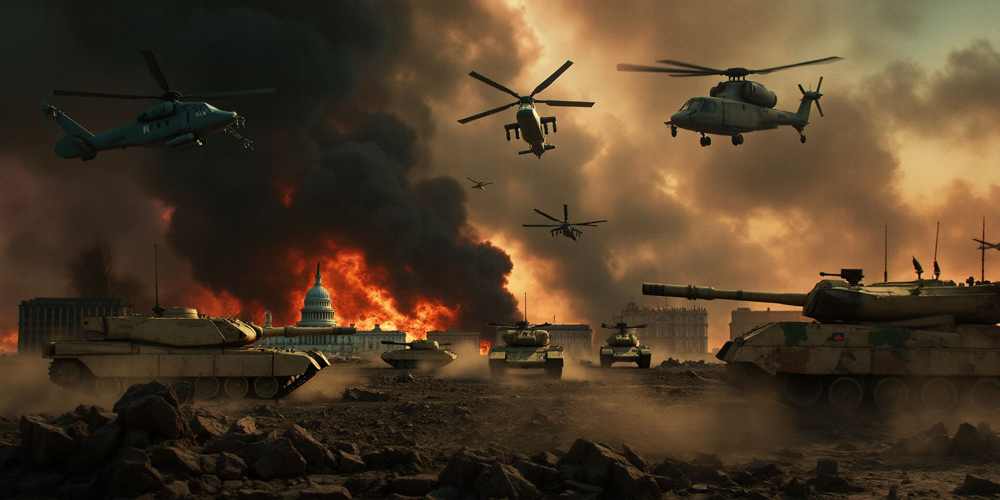

<h1 align="center">ACT OF WAR: REBIRTH</h1>

  <b>Act of War: High Treason, brought back by an old player for everyone who still remembers it.</b> 
  New models, a fourth faction, modern options, and our own online hub on the way.

  <a href="https://github.com/Valkyrie226/aow-rebirth/releases/latest/download/AoW_Rebirth_Setup.exe"><b>⬇ Download the launcher</b></a>
  &nbsp;·&nbsp; <a href="#install">Install guide</a>
  &nbsp;·&nbsp; <a href="#news-and-devlog">News</a>
  &nbsp;·&nbsp; <a href="#suggestion-box">Suggestion box</a>
  &nbsp;·&nbsp; <a href="#roadmap">Roadmap</a>
  &nbsp;·&nbsp; <a href="#faq">FAQ</a>

  
  
  
  

> **Status, 15 Nov 2026:** the first public build, **Rebirth 0.1.0**, is out with the launcher. Skirmish and LAN work now. Our own online server is still being built.
> You need your own copy of *Act of War: High Treason* (GOG or Steam). No original game files are shared here.

---

## What this is

I've played Act of War since 2005. Burning Washington streets, the TV-news briefings, oil money and fast, brutal fights. For a lot of us it was the game of late-night LAN parties and online ladders.

When GameSpy shut down in 2014, the online lobby went dark with it. The game still runs, and the players still remember it, but there's nowhere left to meet.

Rebirth is my answer to that: a free mod that makes the game look and play right on today's screens, a new Eurocorps faction, and a server of our own so we can play together again. It runs on your own copy of the game, and it never replaces your original install.

*Mike, Rebirth project lead*

### The rules I'm holding to

- **Fun first, never overdone.** If a change looks great but slows the match down or hides the battlefield, it doesn't go in.
- **Fair and competitive.** New units have to fight fair against the original three factions. Online, everyone runs the exact same files.
- **The original stays untouched.** The mod lives in a separate copy. Want 2005 exactly as it was? The OG hub is for that.
- **Free, and built with the community.** No price tag and nothing to buy. You send ideas, vote on them and help test.

---

## Contents

- [Download](#download) · [Install](#install) · [Play with friends](#play-with-friends)
- [What's in the mod](#whats-in-the-mod) · [Four armies](#four-armies) · [2005 vs Rebirth](#2005-vs-rebirth)
- [News and devlog](#news-and-devlog) · [Roadmap](#roadmap) · [Gallery](#gallery)
- [Suggestion box](#suggestion-box) · [Community](#community) · [FAQ](#faq) · [Credits](#credits-and-licences)

---

## Download

| | |
|---|---|
| **Launcher setup** | [**AoW_Rebirth_Setup.exe**](https://github.com/Valkyrie226/aow-rebirth/releases/latest/download/AoW_Rebirth_Setup.exe) (always the latest version) |
| **All releases** | [Releases page](https://github.com/Valkyrie226/aow-rebirth/releases) |
| **First download** | About 3 GB. After that, updates only download what changed. |

### What you need

- **Act of War: High Treason**, installed from **GOG** (the version I test with) or **Steam**. Start it once after installing so it sets itself up.
- **Windows 10 or 11.**
- **Free disk space** for the download (about 3 GB) plus a second copy of the game. On the same drive as your game, the big data files are linked instead of copied, so it takes much less room.

> **We never distribute Act of War's own files.** The download only contains Rebirth's new content and the launcher. The launcher builds the modded copy from *your* installed game. If you don't own the game, the mod won't run.

---

## Install

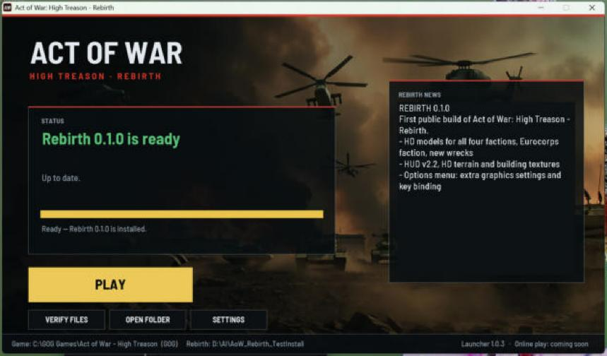

1. **Install the game.** Install High Treason from GOG or Steam and start it once.
2. **Run `AoW_Rebirth_Setup.exe`.** It installs the Rebirth launcher for your Windows user (no admin rights needed) and adds a Start-menu and desktop shortcut.
3. **Let the launcher set up Rebirth.** It finds your game automatically, then builds a separate "Rebirth" copy next to it. Your original folder stays exactly as it is.
4. **Let it update.** The launcher downloads only what changed and checks every file against a signed list. It won't start a modded game until you're up to date.
5. **Press PLAY.** Skirmish offline, or play over LAN with friends. Online play comes when the server is ready.

 

**Launcher buttons**

- **Verify files** re-checks every Rebirth file and repairs anything missing or changed.
- **Open folder** opens your Rebirth copy of the game.
- **Settings** lets you pick a different game folder or install location.

**First start takes a few minutes.** The first time you launch Rebirth, the game builds its model cache (about 3 minutes, depending on your PC). Later starts are fast.

### If Windows warns you

Small community projects usually don't have a paid code-signing certificate, so Windows SmartScreen may warn you the first time. Check that you downloaded the file from this page (`github.com/Valkyrie226/aow-rebirth`), then choose **More info** → **Run anyway**.

Every update the launcher downloads is checked against a list signed with the project's private key. If a file has been tampered with, the launcher refuses it.

### Uninstall

Uninstall *Act of War Rebirth* from Windows **Settings → Apps**, then delete the Rebirth game folder if you want the space back. Your original game isn't affected.

---

## Play with friends

### LAN (works now)

Rebirth keeps the game's original LAN mode.

1. Both players install Rebirth with the launcher and are on **the same version** (the launcher shows it at the bottom).
2. Both PCs must be on **the same local network**: plugged into, or on the Wi-Fi of, the **same router**. If your house has two routers (for example an ISP modem plus your own router), PCs on different routers can't see each other's games.
   *Quick check:* run `ipconfig` on both PCs. The first three numbers of the IPv4 address should match (for example `192.168.0.x` on both).
3. The game's network code uses **DirectPlay**. If the game asks for it, enable it in Windows: *Turn Windows features on or off* → *Legacy Components* → **DirectPlay**. (GOG copies include a `directplay.cmd` in the game folder that does this for you.)
4. One player hosts a LAN game in Multiplayer, the other joins.
5. If the game doesn't show up, allow the Rebirth game exe through Windows Firewall on **private networks**.

### Online (coming)

Our own server is replacing the old GameSpy service, so the lobby comes back to life. **It isn't open yet.** The server computer is being built. Once it passes a two-player test across different networks, a closed beta opens, then the public launch.

**How joining will work**

1. **Own the game:** Act of War: High Treason from GOG (or Steam).
2. **Install the launcher:** you already have it if you installed Rebirth.
3. **Create your account:** one callsign for both hubs, the lobby, chat and the ladder.
4. **Pick a hub and play:** OG or Rebirth. The launcher updates you before each session, so everyone runs the same files and nobody desyncs.

Most players won't need to touch their router: the server helps players connect to each other. Some connections, like mobile hotspots and some shared ISP networks, may still need a port forward. The guide will cover that when the server goes live.

### Two hubs, one community

One account gets you into both. Each hub has its own lobby, so a vanilla player never lands in a modded match.

<table>
<tr>
<td width="50%">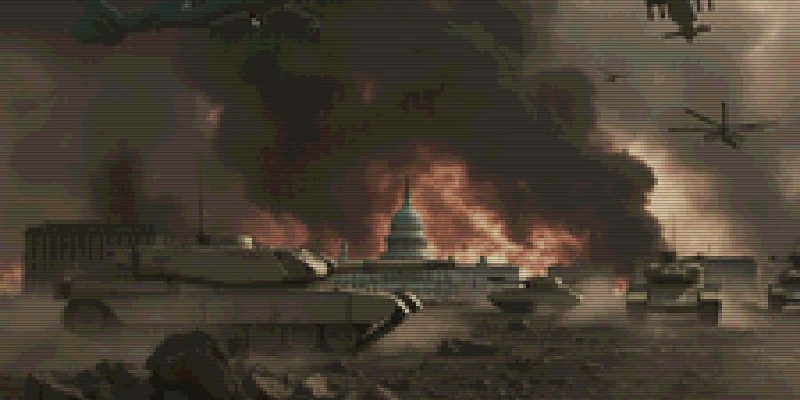 <b>OG hub</b> High Treason exactly as you remember it: the original three factions, models, balance and HUD. For purists and nostalgia nights.</td>
<td width="50%">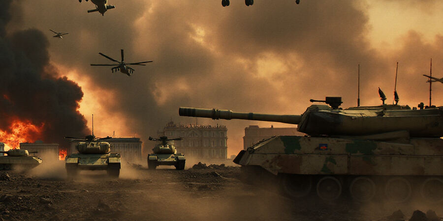 <b>Rebirth hub</b> The modded game: four factions, rebuilt units, the compact HUD and new options, with updates through the launcher.</td>
</tr>
</table>

| Feature | OG hub | Rebirth hub |
|---|---|---|
| Factions | US Army, Consortium, Task Force Talon | The original three, plus Eurocorps |
| Look | Original 2005 models and textures | Rebuilt models, camo, team colours, wrecks |
| Interface | Original HUD | Compact HUD, control groups, key binding |
| Balance | The final official patch | Tuned with updates, after playtesting |
| Updates | Compatibility fixes only | New content through the launcher |
| Ladder | OG ladder | Rebirth ladder with seasons |

---

## What's in the mod

New steel, same game. Everything goes into the game's own data files and gets tested in real matches first.

**Released** = in the current download · **In testing** = built, still being checked in game · **Planned** = not built yet

### Look

| Feature | What it is | Status |
|---|---|---|
| Rebuilt unit models | Detailed models at real-world size for US, Consortium, Task Force Talon and Eurocorps vehicles, helicopters and jets. Infantry comes later. | **Released** |
| Faction looks | US in digital woodland camo with markings and weathering. Consortium in worn steel with black and red. Talon in urban grey. | **Released** |
| Damage and wrecks | A damaged look and a burnt-out wreck built from each unit's own model: 49 US, Consortium and Talon units, plus the Eurocorps ground vehicles. | **Released** |
| HD terrain and buildings | Sharper ground textures and HD building textures on the maps. | **Released** |
| Vehicle lights | Headlights and marker lights on the rebuilt US vehicles. | **Released** |
| Team colours | Your player colour on each unit's accent panels. Done for the Consortium; US and Talon get a subtle version that keeps the camo readable. | In testing |
| Map props | Sharper versions of common props, swapped once and updated on every map. | In testing |
| Base dressing | Sandbags, blast walls, barriers and floodlights around the buildings, using props the developers left in the game. Visual only: footprints and pathing stay the same. | Planned |

### Interface and controls

| Feature | What it is | Status |
|---|---|---|
| Compact HUD | A full-width bottom bar at about 40% of the old height, built for 1440p and 4K. | **Released** (v2.2) |
| Control groups | Six control-group slots replace the mercenary panel, showing each group's lead unit and size. | **Released** |
| Key binding | Rebind 18 unit orders and 8 camera keys, with a duplicate-key check. | **Released** |
| WASD camera | One-click preset: W/A/S/D pan, Q/E rotate, with clashing shortcuts moved out of the way. | **Released** |
| Advanced Video | Brightness, view distance, model detail, texture sharpness, metal shine, dynamic lights, water and shadows. | **Released** |
| Wider zoom | The camera zooms out about 50% further than stock. | In testing |
| New icons | Detailed icons for every unit and building, Eurocorps first. | In testing |
| New menus | A new main menu with animated art, news, profile and server panels, plus new skirmish, score and pause screens. | Designed, being built |
| Modern graphics wrapper | Smoother frame rates and anti-aliasing on modern Windows. | In testing |

### Eurocorps, the fourth faction

| Feature | What it is | Status |
|---|---|---|
| Playable faction | Its own HQ, barracks, factories, air operations and defence sites, with vehicles and aircraft from across Europe. | **Released** |
| Buildings | Realistic NATO look with small EU touches and no flags. | **Released**, more in progress |
| Unique abilities | Abilities based on what the real vehicles can do, bought at the building that makes the unit, the original Act of War way. | Planned |
| Voices | Short voice lines for every Eurocorps unit. | Planned |

### Online

| Feature | What it is | Status |
|---|---|---|
| Launcher | Finds your game, builds the modded copy next to it, keeps everyone on the same version and shows the news. | **Released** |
| LAN play | The game's own LAN mode, working on the modded copy. | **Released** |
| Our own server | Replaces the dead GameSpy service: accounts, lobby, chat, connection help and match results. | Planned |
| Ladder and stats | Ratings, win rates by faction and monthly seasons. | Planned |

### What I'm not changing

The pace, the economy, the way each of the original factions plays. Rebirth is supposed to feel like Act of War on a better screen, not a different game. Balance changes only go in after they've been played, and only if they keep the game fun.

### How a change gets in

Each change is built, installed in a test copy with a backup, played in game, and only then kept. One thing at a time, so when something breaks we know exactly what did it.

---

## Four armies

The original three keep their identity and play style. Eurocorps joins them as an equal: competitive, never the obvious pick.

<table>
<tr>
<td width="50%" valign="top">
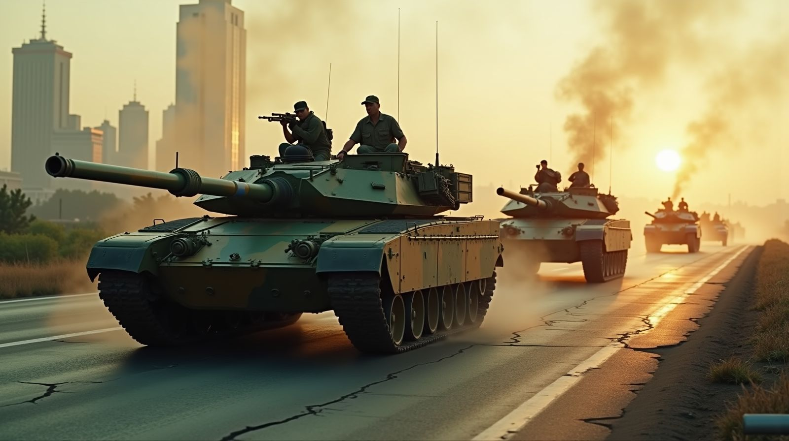
<h3>US Army</h3>
<i>Heavy armour and air power.</i> Hits hard and takes punishment. Strong tanks, infantry fighting vehicles and long-range artillery, backed by helicopters and air strikes.  
<b>Signature units:</b> Abrams, Bradley TOW, Paladin, MLRS, Avenger, Apache, Patriot 
<b>Rebirth look:</b> digital woodland camo, markings and weathering, working lights
</td>
<td width="50%" valign="top">
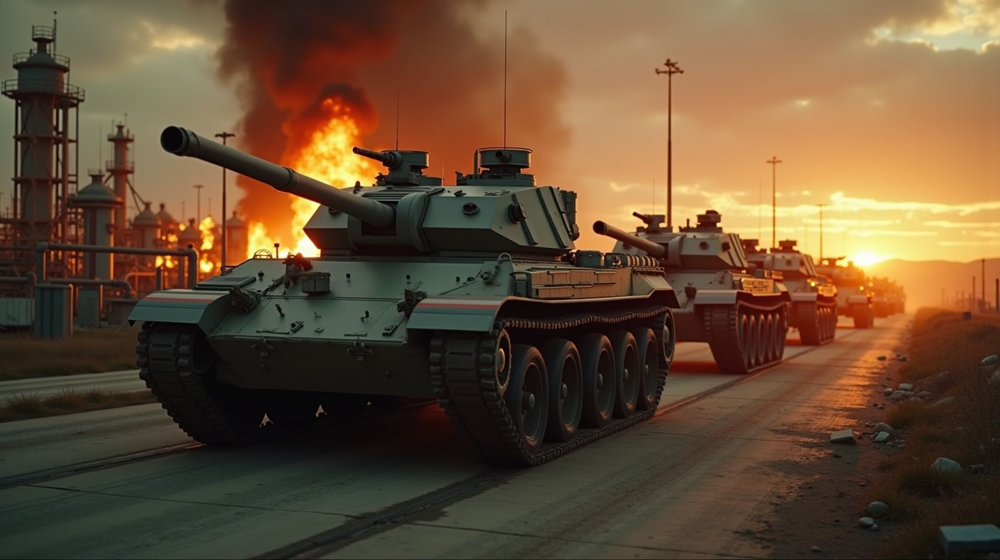
<h3>Consortium</h3>
<i>Oil-funded shadow army.</i> Cheap, fast and ruthless. Ex-Soviet armour, gunships, stealth units and dirty tricks.  
<b>Signature units:</b> Akula, BTR-80, Tunguska, Porcupine, Piranha, Hind, Tu-160 
<b>Rebirth look:</b> worn steel and gunmetal with black and red accents
</td>
</tr>
<tr>
<td width="50%" valign="top">
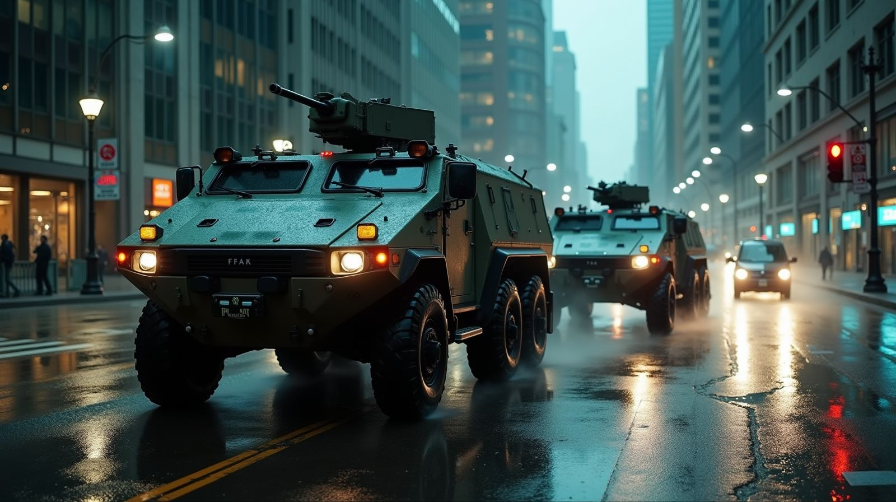
<h3>Task Force Talon</h3>
<i>High-tech strike force.</i> Elite and expensive. Drones, stealth and fast wheeled units that win with information and precision.  
<b>Signature units:</b> Stryker, Buggy, Spinner drones, Comanche, V-44, F-35, Global Hawk 
<b>Rebirth look:</b> dark urban grey with small hazard-stripe accents
</td>
<td width="50%" valign="top">
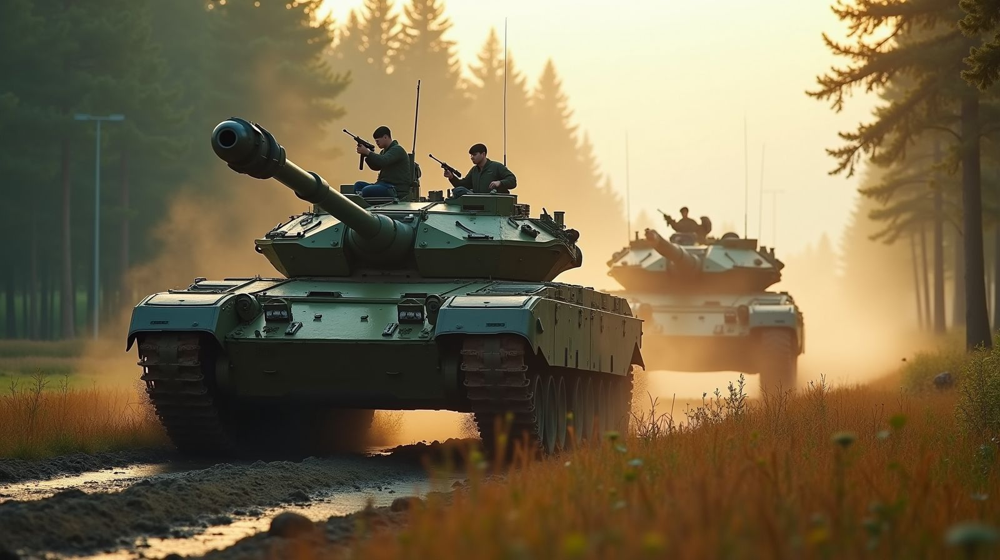
<h3>Eurocorps NEW</h3>
<i>Coalition doctrine.</i> A European coalition army and the fourth playable faction. Joint procurement makes its vehicles cheaper. Its unique abilities come from what the real vehicles can do, built on mechanics the game already has.  
<b>Signature units:</b> Leopard 2A8, CV90, PzH 2000, CAESAR, Centauro II, Skyranger 30, IRIS-T SLM, SAMP/T, Tiger, NH90, Rafale, Typhoon, Eurodrone 
<b>Infantry:</b> Riflemen, Engineers, KSK, Mistral team, Medic and more 
<b>Rebirth look:</b> realistic NATO kit with small EU accents and no flags
</td>
</tr>
</table>

Faction pictures are Rebirth key art (AI-assisted, see <a href="#credits-and-licences">credits</a>). Their vehicles are realistic stand-ins, not exact in-game models. In-game screenshots are in the <a href="#gallery">gallery</a>.

### 2005 vs Rebirth

Studio renders of the actual models: the stock model from the 2005 game files (left) and the Rebirth model (right).

| 2005 original | Rebirth |
|---|---|
| 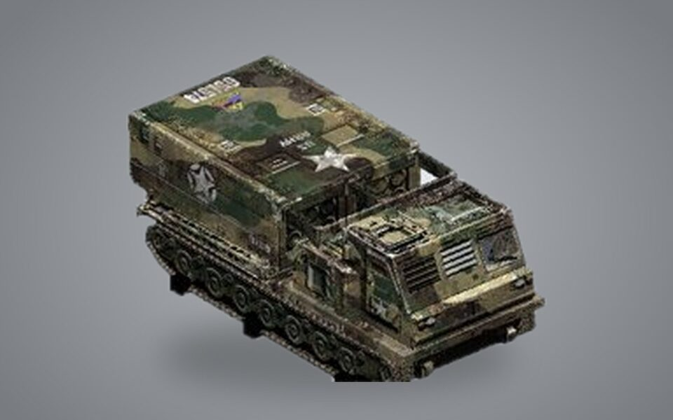 | 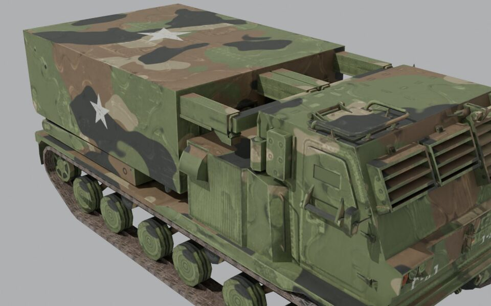 |
| **US M270 MLRS.** The stock model (1,172 triangles) next to the rebuilt MLRS in woodland camo. The launcher pod on the new one rises and fires in game. | |
| 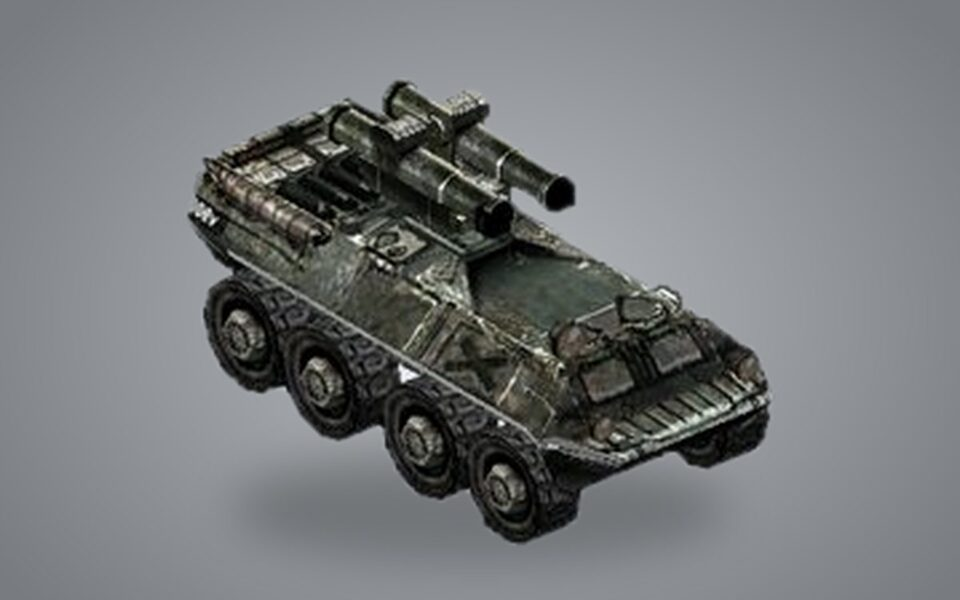 | 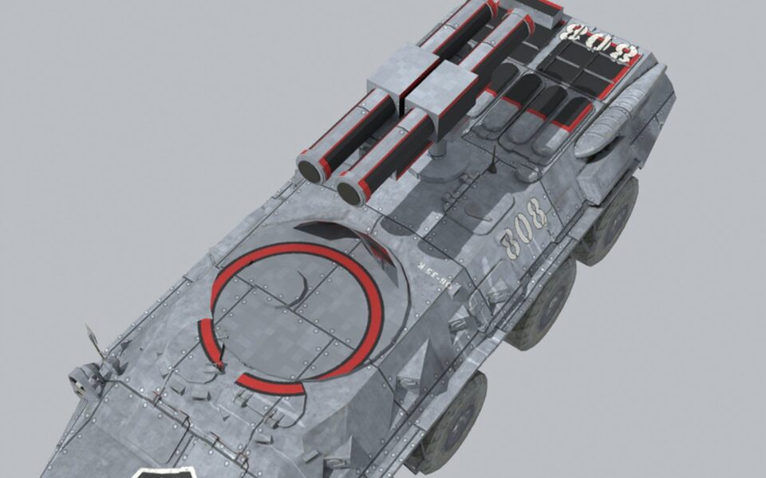 |
| **Consortium BTR-80.** The stock BTR-80 (2,315 triangles) next to the rebuilt one in worn steel with black and red accents. | |
| 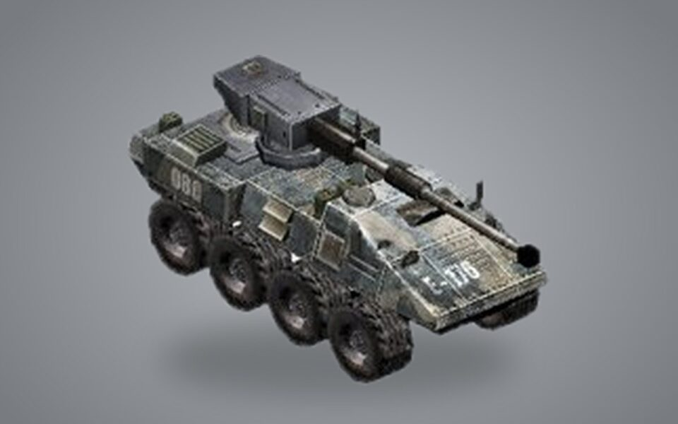 | 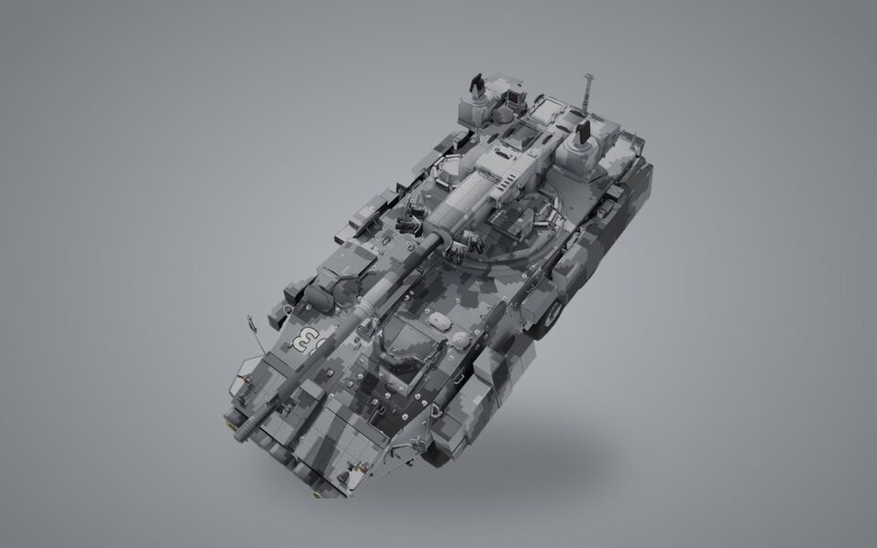 |
| **Talon Stryker MGS.** The stock Stryker MGS (1,349 triangles) next to the rebuilt Stryker in Talon's urban digital camo. | |
| 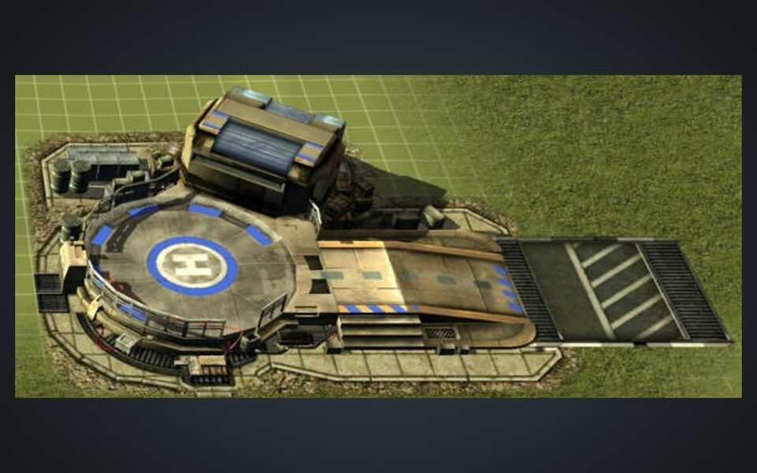 | 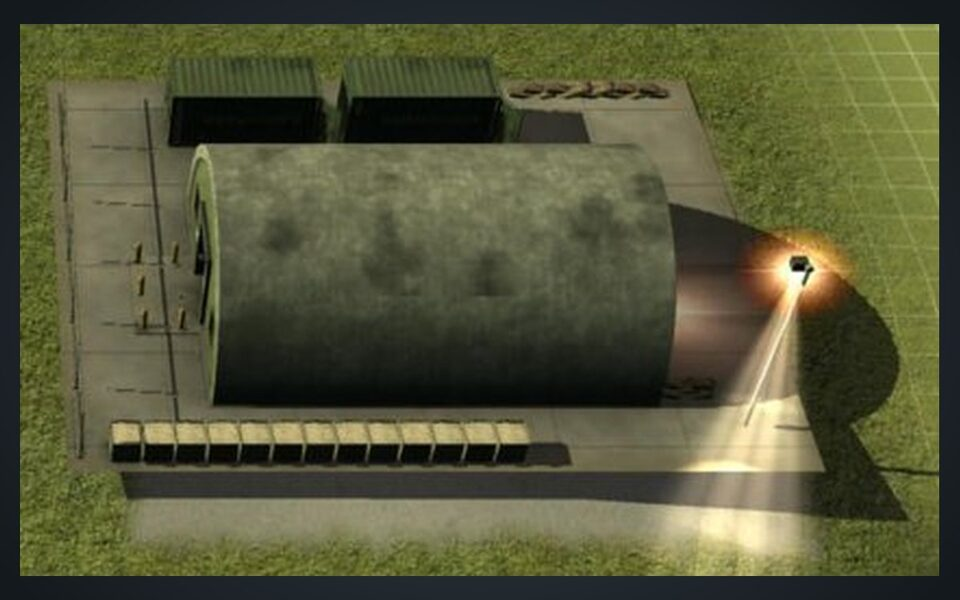 |
| **Vehicle factory.** Eurocorps didn't exist in 2005, so the closest stock building stands in: the US Heavy Factory next to the new Eurocorps Vehicle Hall (in-game screenshots, not at the same scale). | |

---

## News and devlog

What changed in the game, newest first.

### 15 Nov 2026 · Rebirth 0.1.0 and the launcher are out

The first public build is here, together with the launcher that installs and updates it.

- **Launcher:** finds your GOG or Steam copy, builds a separate Rebirth copy next to it and keeps it up to date. Updates are split into small packs, so you only download what changed, and every file is checked against a signed list.
- **In 0.1.0:** HD models for all four factions, the Eurocorps faction, new wrecks, HUD v2.2, HD terrain and building textures, and the options mod with extra graphics settings and key binding.
- **Next:** the brother-vs-brother LAN test, then the new menus.

### 15 Nov 2026 · Eurocorps wrecks and HUD 2.2

- Eurocorps ground vehicles used to drop US, Talon or Consortium wrecks when they died. Now each one leaves its own burnt-out hull and has its own damaged look, from the Leopard 2A8 to the Kodiak with its arm still on.
- HUD 2.2: building icons now fit the control-group slots properly.

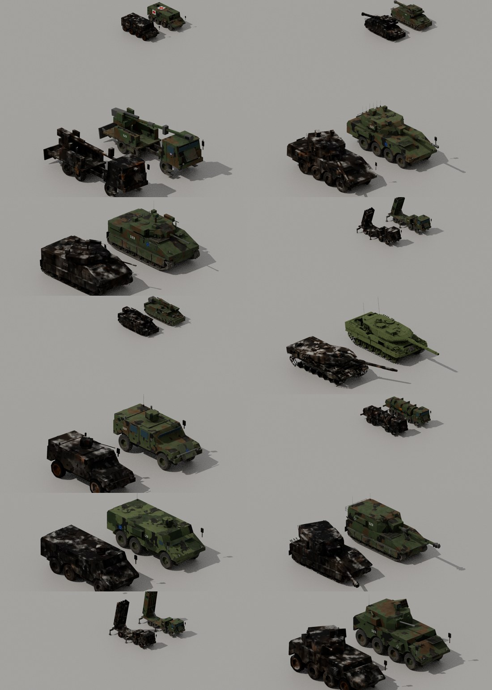

### 13 Nov 2026 · HD ground, slabs and civilian cars

Sharper terrain textures across the maps, an HD concrete slab under the buildings, and the civilian cars and trucks on the maps rebuilt.

<table>
<tr>
<td width="50%">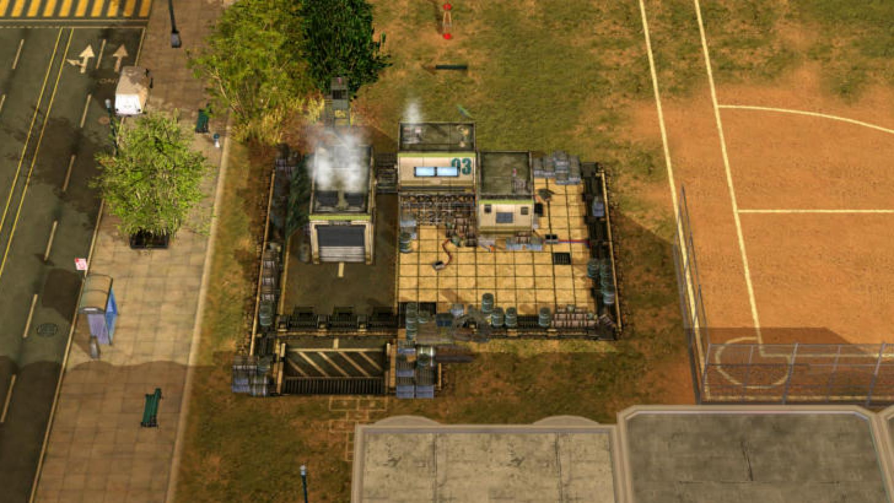</td>
<td width="50%">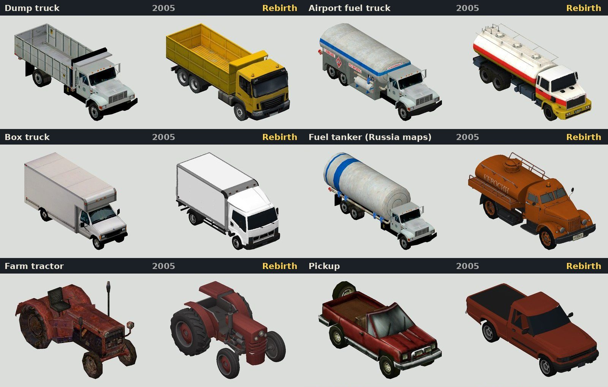</td>
</tr>
</table>

### 09 Nov 2026 · Wrecks that look like what you just destroyed

When you killed a rebuilt tank, the game still dropped the old 2005 wreck model, so a brand-new Abrams turned into a shiny grey lump. That's fixed. Every rebuilt US, Consortium and Talon unit, 49 in all, now has two new versions built from its own model:

- **Damaged:** charred and smoking, same shape, still driving and shooting until it dies.
- **Wreck:** burnt-out hull, turret knocked off-line, gun drooping, sitting lower on its tracks.

That covers 29 ground vehicles, 13 helicopters and 7 jets. The smoke and fire effects were checked against each new hull so they still come out of the right spots.

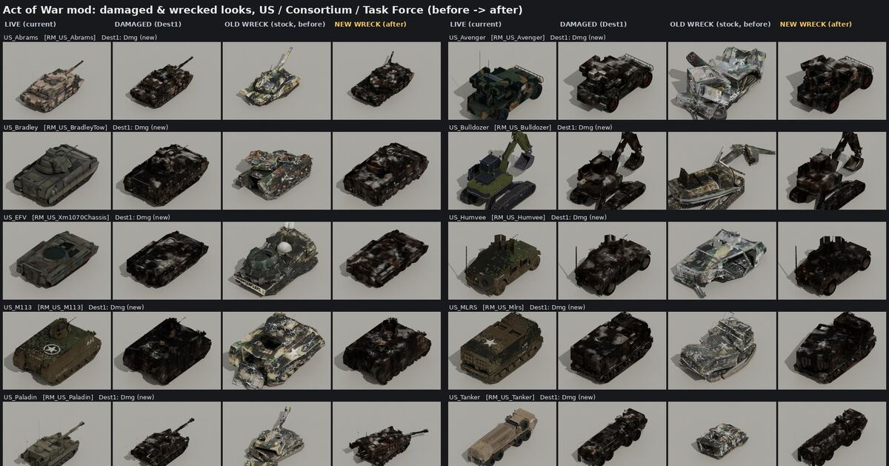

### 09 Nov 2026 · Sharper props on every map

The maps are full of small stuff: barrels, barriers, floodlights, sandbags. I catalogued every stock object in the game, 828 of them, and checked how often the 75 stock maps use each one. Maps don't store their own copy of a prop; they point to one shared model. Replace that model once and every map gets the upgrade. The pilot covers the oil drum, the Jersey barrier and floodlight 1. Same size, same footprint, so nothing changes for pathing or line of sight.

### 09 Nov 2026 · Team colours, done the game's way

The accent panels on each rebuilt model now take your player colour, and the rest of the paint stays as it is. Tested on the BTR-80 first, then rolled out to 20 more Consortium models. US and Talon get a subtle version that tints only the markings, so the camo stays readable.

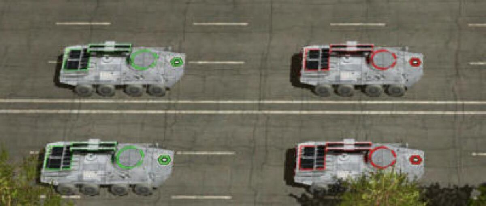

### 08 Nov 2026 · Your keys, your camera

The Options screen has two new tabs next to the stock one.

- **Controls** lets you rebind 18 unit orders (attack, move, stop, patrol, defend, ambush, capture, barrage fire, deploy, sell and more) and all eight camera keys, with a warning for duplicate keys.
- **WASD camera** is one button: W/A/S/D pan, Q/E rotate, and the orders that used those letters move out of the way. Tapping D no longer blows up your derrick.
- **Advanced Video** adds brightness, view distance, model detail, texture sharpness and filtering, metal shine, dynamic lights, water reflections and shadow quality. *Default* puts everything back to stock.

Known limit: tooltips still show the old letter, for example "[D]".

<table>
<tr>
<td width="50%">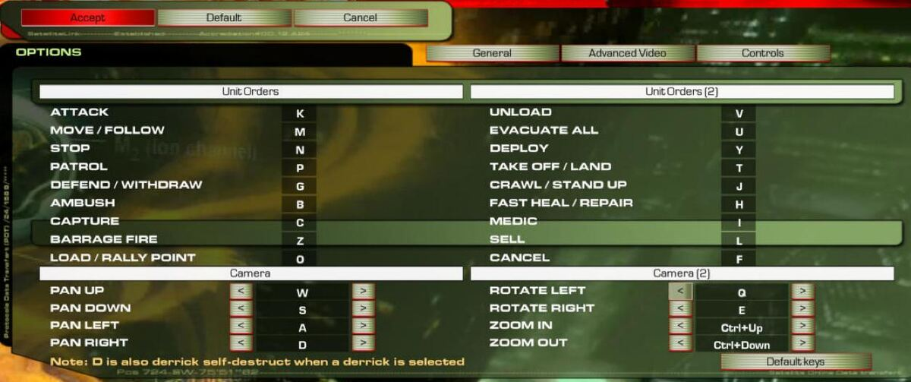</td>
<td width="50%">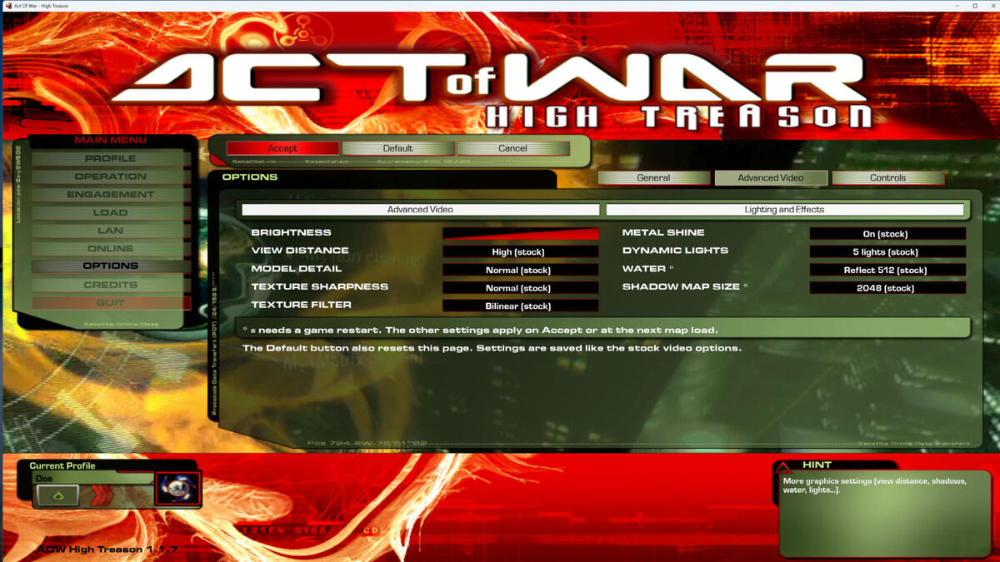</td>
</tr>
</table>

### 07 Nov 2026 · More room to see the fight

The maximum zoom-out is about 50% further than stock, so you can follow a whole push without scrolling around. Everybody gets the same limit.

### 07 Nov 2026 · New units: the US and the Consortium, rebuilt

The US and Consortium units now use detailed new models, scaled to real-world size and fitted to the game's turrets, weapons and effects.

- **US:** Abrams, Bradley, Paladin, MLRS, Avenger, Humvee, M113, EFV, the fuel tanker and the bulldozer, plus the Apache, Black Hawk, Medevac, Kiowa and Skycrane.
- **Consortium:** Akula, BTR-80, Tunguska, Porcupine, Fennek, Piranha and the rest. The Porcupine's deployed mode now sits behind real sandbags.

One fix worth calling out: the MLRS launcher frame used to stay behind on the truck when the pods rose to fire. Now the whole launcher lifts as one block, and the rockets leave from the tube ends.

<table>
<tr>
<td width="50%">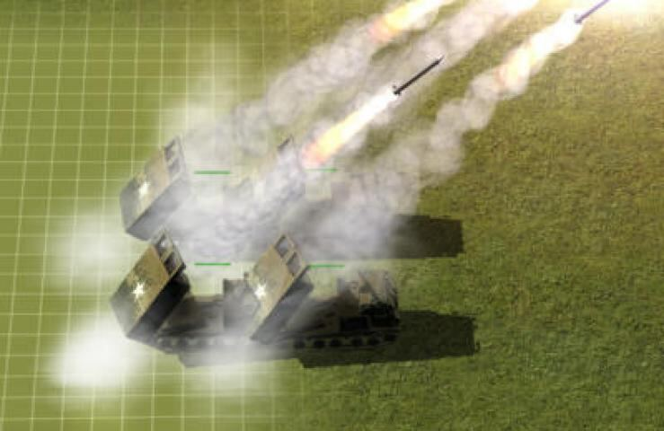</td>
<td width="50%">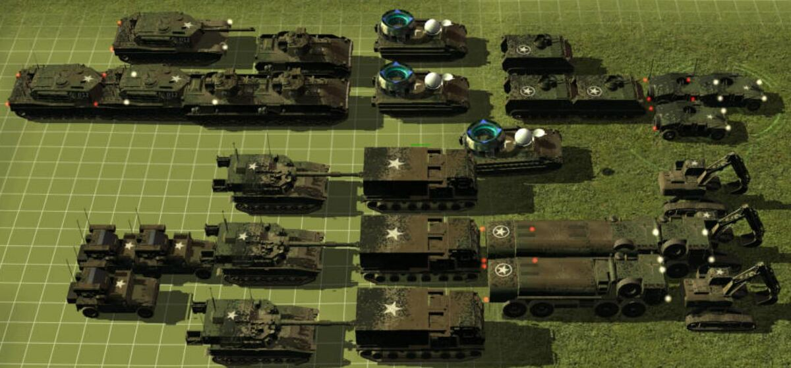</td>
</tr>
</table>

### 06 Nov 2026 · Talon goes urban grey, and the tilt-rotors fly right

Task Force Talon is repainted in dark urban grey with small hazard-stripe accents. The V-22 and V-44 engines now tilt the right way in flight. The first Eurocorps buildings were rebuilt for a realistic NATO look; the HQ has a roof helipad and a satellite dish that turns.

### 03 Nov 2026 · A HUD for 4K screens

The old bottom bar covered about a third of the screen. The new one is a compact full-width bar at about 40% of the old height, so the battlefield runs nearly the full height of your screen. The mercenary panel is gone; six control-group slots take its place. One click selects the group.

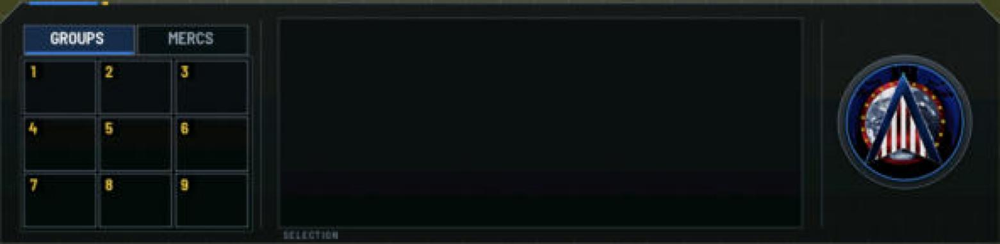

---

## Roadmap

Each phase has to pass a real test before the next one starts. No dates promised: it ships when it works.

### Getting online

| # | Phase | What it means | Status |
|---|---|---|---|
| 0 | Server and domain | Build the dedicated server computer, open the network, register the domain. | **Now** |
| 1 | Master server | Accounts, lobby, chat, connection help and match results. Done when two players on different networks finish a match. | Planned |
| 2 | Launcher | Finds your GOG or Steam install, builds the Rebirth copy, updates only what changed, keeps versions locked. | **Done** (v0.1.0) |
| 3 | Ladder and stats | Ratings, win rates by faction, streaks and monthly seasons. | Planned |
| 4 | Website live | The Rebirth site on our own domain, with news, downloads, server status and the ladder. | Planned |
| 5 | Beta, then launch | A closed beta with 5 to 10 players, fixes for connection and sync issues, then the public announcement. | Planned |

### In the workshop now

- **New menus:** the animated-art main menu with news, profile, hints and server panels, plus new skirmish, score and pause screens.
- **Unit-by-unit inspection:** every unit checked building by building: looks, animations, weapon effects, how it leaves the factory, and how it blows up.
- **Props and base dressing:** more upgraded map props, then the stock sandbags, walls and lights placed around each faction's buildings.
- **Eurocorps buildings:** the rest of the buildings in the same NATO style as the HQ, Barracks and Vehicle Hall.

### Future projects

Your [suggestions](#suggestion-box) can move things up this list.

| When | Project |
|---|---|
| Next | **Eurocorps abilities and voices:** unique abilities picked one at a time, and voice lines for every unit. |
| Next | **New maps:** fresh battlefields for 1v1 and team games, plus touched-up classics. |
| Next | **Infantry:** new infantry models, starting with Eurocorps. |
| Next | **Seasons and tournaments:** monthly ladder resets, community cups and a hall of fame. |
| Later | **Effects and craters:** better explosions, smoke and ground damage, once everything else runs smoothly. |
| Later | **Replays:** upload, browse and watch the best matches from the ladder. |
| Later | **Naval units:** Eurocorps ships, after the land and air game is solid. |
| Long term | **A new engine:** a separate, later project: the same game on a modern renderer. |

---

## Gallery

Screenshots and renders from the development build. They may change before the next release.

<table>
<tr>
<td width="33%"> US ground vehicles with camo and lights</td>
<td width="33%">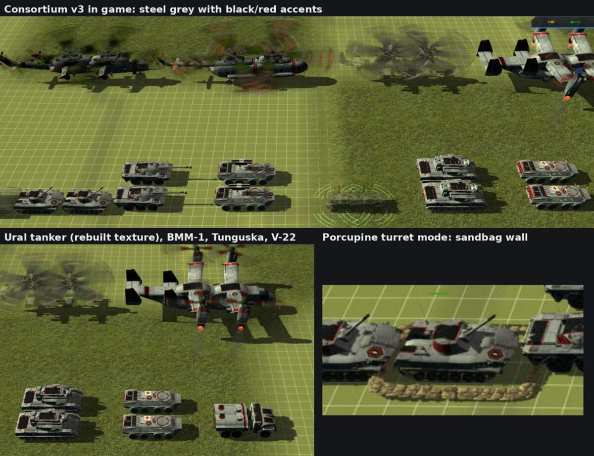 Consortium in worn steel</td>
<td width="33%">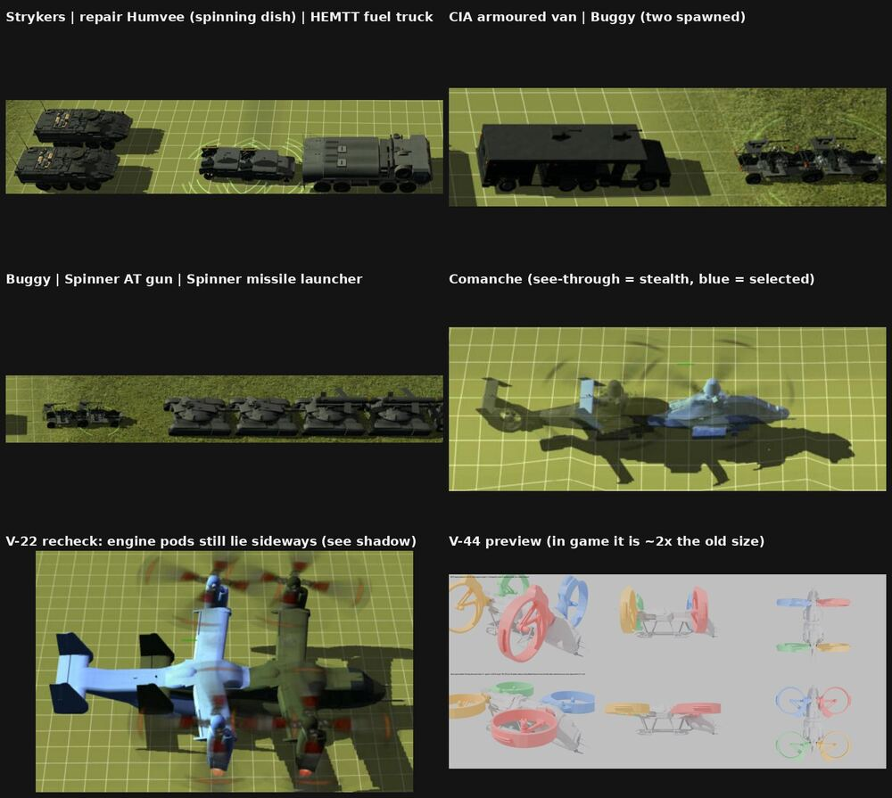 Task Force Talon in urban grey</td>
</tr>
<tr>
<td>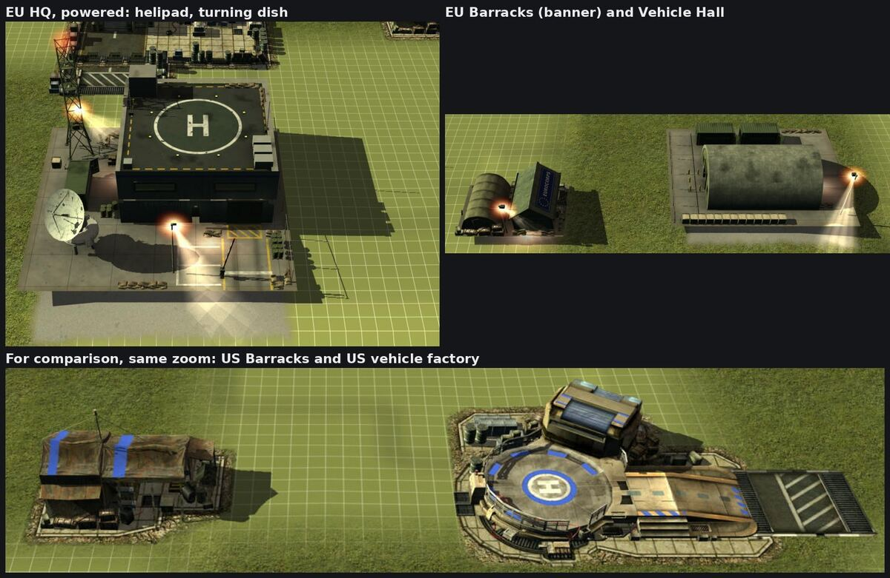 Eurocorps HQ, Barracks and Vehicle Hall</td>
<td>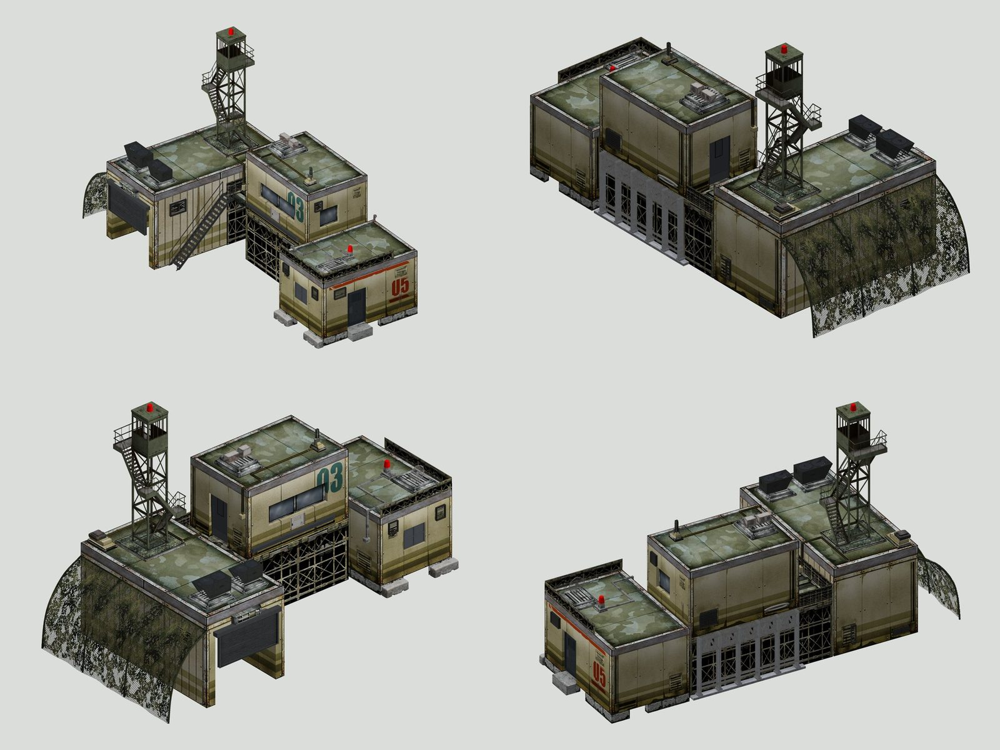 Rebuilt US HQ</td>
<td>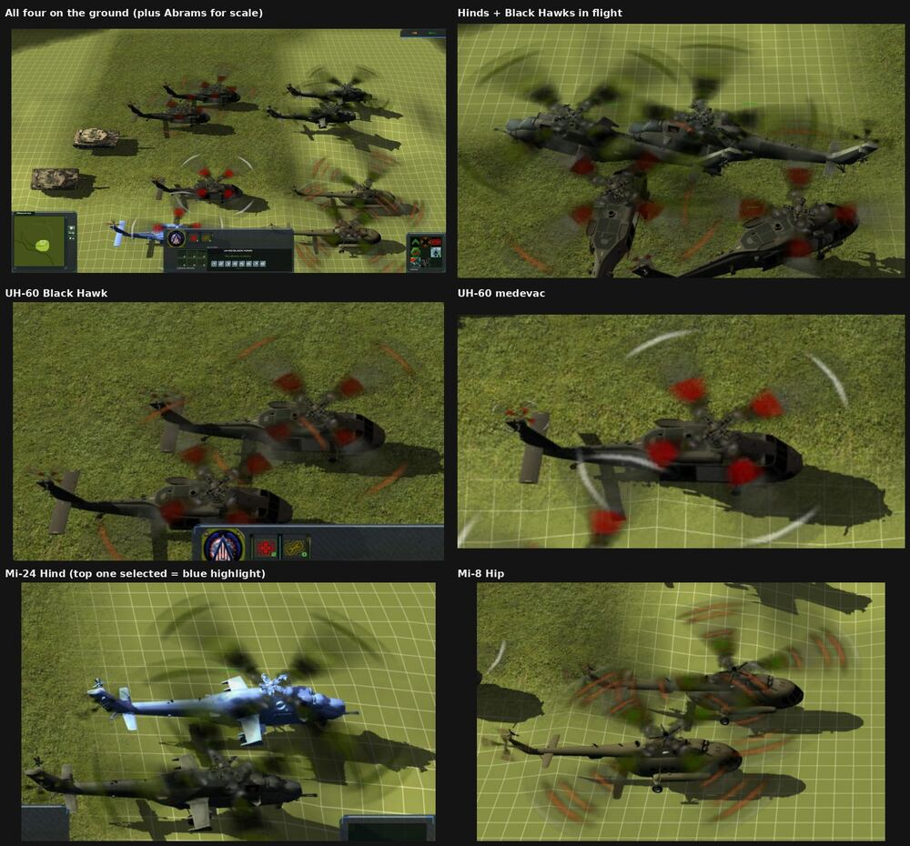 Rebuilt helicopters</td>
</tr>
<tr>
<td>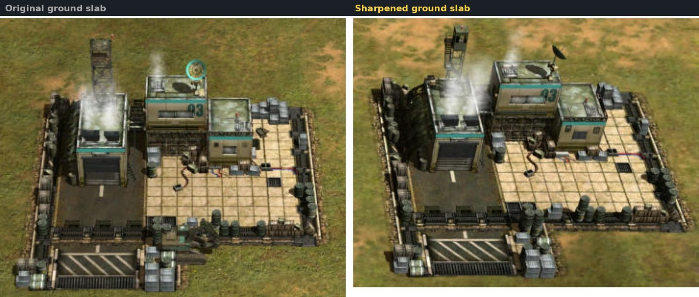 HD concrete slab</td>
<td>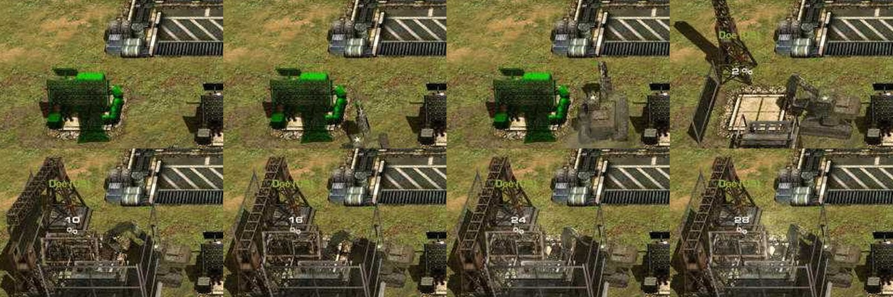 The excavator's new dig animation</td>
<td> Damage stages and new wrecks</td>
</tr>
</table>

---

## Suggestion box

Want a unit, a map, a balance change or a fix? Post it, and vote for the ideas you want most. The best ones get playtested.

**➜ [Post an idea](https://github.com/Valkyrie226/aow-rebirth/issues/new?template=suggestion.yml)** &nbsp;·&nbsp; **[Report a bug](https://github.com/Valkyrie226/aow-rebirth/issues/new?template=bug_report.yml)** &nbsp;·&nbsp; **[Browse ideas by votes](https://github.com/Valkyrie226/aow-rebirth/issues?q=is%3Aissue+is%3Aopen+label%3Asuggestion+sort%3Areactions-%2B1-desc)**

You need a free GitHub account to post. To vote, give an idea a 👍 reaction.

**What happens to your idea**

1. **Post it:** one idea per post, so people can vote on it.
2. **The community votes:** the most-wanted ideas rise to the top.
3. **We try it:** promising ideas get built and playtested for fun and balance.
4. **It ships:** if it keeps the game fun and fair, it lands in an update, and the news post says whose idea it was.

---

## Community

Rebirth is for the players. Here's where we talk, test and organise games.

- **Discord:** match-making, bug reports, playtest sign-ups and the beta. *Invite coming soon.*
- **GitHub:** releases, the [suggestion box](#suggestion-box) and bug reports, right here.

### Ways to help

- **Play and report.** Tell us what broke, on which map, with which units.
- **Suggest and vote.** The suggestion box decides what we try next.
- **Join the beta.** We need players on different connections to test the server.
- **Bring the old crew.** If you played in 2005, find your old clan mates.

### House rules

- Be decent. Trash talk stays about the match, never the person.
- No cheating, no exploits on the ladder. Found one? Report it, don't use it.
- No sharing game files or cracked copies. Everyone brings their own copy.
- English in the public channels, so everyone can follow.

**Shout-out** to everyone who kept Act of War alive on forums, fan sites and old LAN setups since 2014. This one's for you.

---

## FAQ

<b>Is this official?</b>

No. Act of War: Rebirth is an unofficial, non-commercial fan project. It isn't affiliated with or endorsed by the game's developer or publisher.

<b>Do I need to own the game?</b>

Yes. You need Act of War: High Treason, from GOG or Steam. Rebirth builds on your copy and never distributes the original game files.

<b>Will it change my original install?</b>

No. Rebirth installs as a separate copy, so your original game stays exactly as it is.

<b>Does it cost anything?</b>

No. It's free, with nothing to buy and no paid advantages.

<b>How big is the download?</b>

About 3 GB the first time. After that, the launcher downloads only the parts that changed.

<b>When can I play online?</b>

When the server passes its tests, a closed beta opens, then the public launch. There's no date yet; watch this page. Skirmish and LAN work now.

<b>Can I still play the original game online?</b>

That's the plan for the OG hub: the original three factions and balance, with its own lobby and ladder, on the same server.

<b>Why two hubs?</b>

Some players want 2005 exactly as it was, others want the new content. Separate lobbies let both play without mismatched files breaking a match.

<b>Is Eurocorps overpowered?</b>

It shouldn't be, and that's the rule. It's built to be competitive with the original three, and its abilities only use mechanics the game already has. Balance gets tuned through playtesting.

<b>Does Direct Action work, or only High Treason?</b>

Rebirth is built on Act of War: High Treason. Direct Action on its own isn't supported.

<b>Will it run on my PC?</b>

If the original runs, Rebirth should too. The new models are more detailed, so the Advanced Video page lets you lower model detail and shadows on older machines. The first launch takes a few minutes while the game builds its model cache.

<b>My friend and I can't see each other's LAN game.</b>

Both PCs must be on the same router and on the same Rebirth version. See <a href="#lan-works-now">LAN</a> for the checklist (same network, DirectPlay, firewall).

<b>Why does Windows warn me about the launcher?</b>

Small community projects often don't have a paid code-signing certificate, so SmartScreen may warn you the first time. Only download it from this page. The launcher itself checks every update against a signed file list.

<b>Can I help?</b>

Yes. Play, report bugs, post ideas in the suggestion box and sign up for the beta when it opens.

---

## Credits and licences

Rebirth stands on a lot of other people's work. **Full list: [CREDITS.md](CREDITS.md).**

- **The game:** Act of War: Direct Action (2005) and Act of War: High Treason (2006) were developed by Eugen Systems. The games and their trademarks belong to their respective owners. Rebirth doesn't include or share any of the game's own files.
- **Rebirth:** project lead, testing and direction by Mike. Model conversion, the converter, the options mod, the launcher and much of the build work were done with Claude, an AI assistant by Anthropic.
- **3D models:** over 100 models by Sketchfab creators, each rescaled, reduced, repainted and converted for Act of War. Every model's credit also ships with the mod in its `LICENSE_AND_CREDIT.txt` file. None of the creators endorse this mod.
- **Key art:** a Blender scene of the mod's units, painted with FLUX.1-dev (Black Forest Labs, non-commercial licence) through ComfyUI.
- **Fonts:** Barlow and Barlow Condensed by Jeremy Tribby, SIL Open Font License.
- Logo, faction emblems, decals and markings are original artwork made for Rebirth.

Some models are licensed for **non-commercial use only** (marked NC in the credits). That's one more reason Rebirth stays free.

---

Act of War: Rebirth is an unofficial, free fan project. It is not affiliated with, endorsed or sponsored by the developer or publisher of Act of War. Act of War is a trademark of its respective owner. A legally owned copy of Act of War: High Treason is required.
